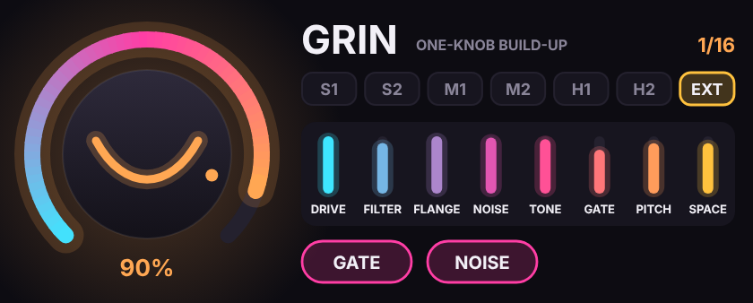

# GRIN for Max for Live

A native Max for Live audio effect: the same DSP as the AU/VST3 version, ported to a single `gen~` codebox. It needs Ableton Live Suite, or Live Standard with the Max for Live add-on.

## Install

**Keep `GRIN.amxd` and `grin_ui.js` in the same folder.** The device loads its interface from that file.

1. Drag `GRIN.amxd` onto any audio or group track, or onto the master.
2. To keep it in your browser, save it to your User Library (`Music/Ableton/User Library/Presets/Audio Effects/Max Audio Effect/`).

## Controls

| Control | What it does |
|---------|--------------|
| **Smile** (big knob) | The one knob. Drag up/down (hold Shift for fine control, double-click to reset). Automate it 0 → 100 % over the build, then snap it back to 0 for the drop |
| **Strength** (tabs) | S1, S2 = Soft · M1, M2 = Medium · H1, H2 = Hard · EXT = Extreme |
| **GATE** | Stutter gate locked to Live's transport (1/4 → 1/8 → 1/16 → 1/32) |
| **NOISE** | White-noise riser that follows your track |

All four controls are real Live parameters, so you can automate them, map them to MIDI, or put them in a rack macro.

## Notes

- The interface is drawn by `grin_ui.js`, and the real Live parameters sit hidden behind it, so automation lanes still show *Smile*, *Strength*, *Gate* and *Noise*. To make a single self-contained file: open the device in Max (the edit button in its title bar), click **Freeze Device** in the toolbar, then save. The frozen `.amxd` carries the script inside it.
- The stage meters show how hard each effect is working. The gate readout (1/4 … 1/32) pulses with the gate.
- The gate follows Live's transport (`phasor~ 1n @lock 1`). With the transport stopped, it holds still.
- At 0 % the device passes audio through untouched.

## Files

- `GRIN.amxd`: the device
- `grin_ui.js`: the device's interface (keep it next to the .amxd)
- `GRIN.maxpat`: the same patch as a plain Max patcher (backup, or for editing in Max)
- `grin.genexpr`: the gen~ DSP code, for reading or pasting into your own gen~
- `build_amxd.py`: regenerates all three from source (`python3 build_amxd.py`)
